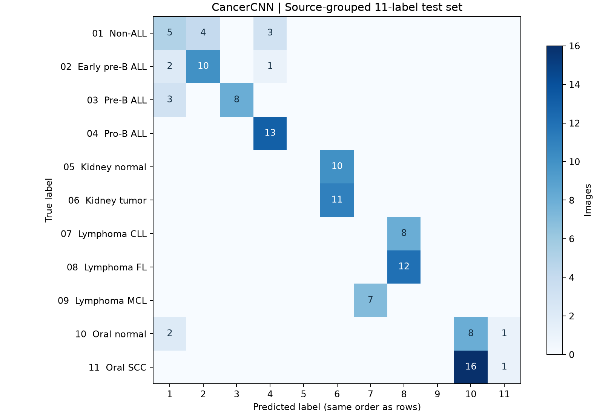

# Multi-Cancer Image Analysis

**English** | [简体中文](README.zh-CN.md)

A PyTorch project for multi-source medical image classification. It combines an image classification pipeline, source-grouped evaluation, and a small external lung cohort analysis. The label set includes normal and benign samples as well as cancer-related subtypes.

## Results

| Experiment | Evaluation unit | Result |
| --- | --- | --- |
| CancerCNN, 11 labels | 125 held-out images, grouped by recorded source | 68/125 correct (54.40%); macro F1 0.4424 |
| ResNet-18 baseline, same split | The same 125 images | 58/125 correct (46.40%); macro F1 0.3529 |
| Lung adaptation on TCGA | 10 evaluable cases, 80 tiles | 0/10 baseline vs. 5/10 adapted cases correctly classified |



The 11-label split separates recorded source groups. Patient-level independence is unverified. The historical 26-label experiment had confirmed source-image overlap across its training and test sets. The external lung evaluation covers adenocarcinoma and squamous cell carcinoma, with two of twelve preselected cases lacking eligible tiles. These results describe the recorded experiments.

## Quick start

Tested with Python 3.12 on Windows x64 using CPU PyTorch. Install dependencies, then execute the end-to-end synthetic smoke test from the repository root.

```sh
python -m pip install -r requirements.txt
python smoke_test.py
python -m unittest discover -s tests -q
```

The smoke test generates small synthetic RGB images and exercises data preparation, split checks, training, evaluation and inference. To train on your own class folders, use the following workflow.

```sh
python -m cancer_lab prepare --root /path/to/class_folders --groups-csv /path/to/groups.csv --output outputs/manifest.json
python -m cancer_lab check-splits --manifest outputs/manifest.json
python -m cancer_lab train --manifest outputs/manifest.json --config configs/baseline.json --output outputs/run
python -m cancer_lab evaluate --manifest outputs/manifest.json --checkpoint outputs/run/best.pt --output outputs/run/test --device cpu
python -m cancer_lab predict --checkpoint outputs/run/best.pt --image /path/to/image.png --device cpu
```

The group CSV contains `path,group_id`. Paths are relative to the image root. Use source-image, slide or patient groups according to the available evidence.

## Repository structure

- `cancer_lab/` contains models, preprocessing, split checks, training, evaluation and inference.
- `configs/` contains example training settings.
- `results/` contains aggregate metrics, training histories and the recorded evaluation configurations.
- `tests/` covers split checks, checkpoint handling and training recovery.
- [Data sources and evaluation notes](docs/data-and-evaluation.md) lists the upstream sources and protocol.

Research prototype for evaluating image classification workflows. Use upstream repositories to obtain data under their applicable terms.
