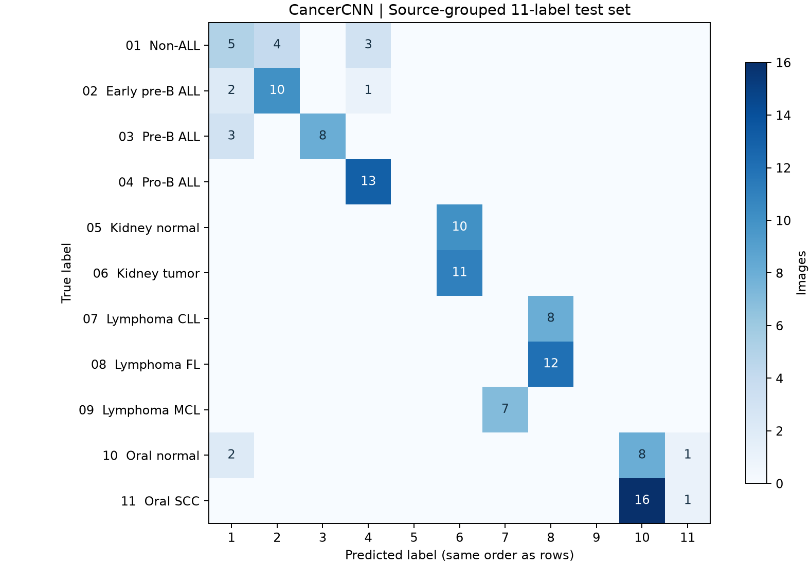
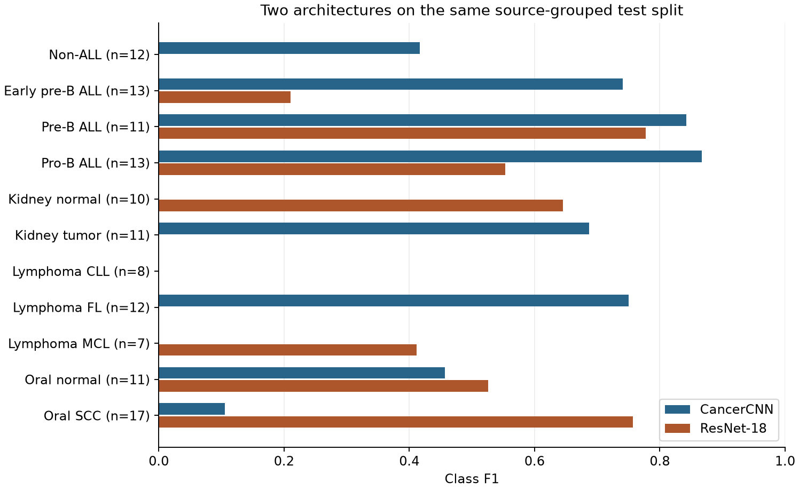
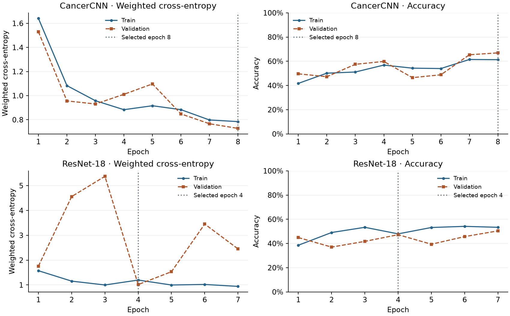

# 多类型癌症图像分析

[English](README.md) | **简体中文**

基于 PyTorch 的多来源医学图像分类项目，提供图像处理、来源分组、训练、评估和推理。类别包含正常、良性及肿瘤相关亚型。实验重点是观察不同标签、划分方式和外部来源下的错误。

## 主要结果

| 实验 | 样本 | 结果 |
| --- | --- | --- |
| 自建 CancerCNN，11 类来源分组 | 125 张测试图 | 68/125 正确，准确率 54.40%，宏平均 F1 为 0.4424 |
| ResNet-18，使用相同划分 | 同一批 125 张测试图 | 58/125 正确，准确率 46.40%，宏平均 F1 为 0.3529 |
| TCGA 肺部适配 | 10 个可评估病例，80 张图块 | 病例命中从 0/10 到 5/10 |



11 类实验隔离了已记录的来源组，患者独立性仍待验证。历史 26 类图像级结果存在已查实的跨集合原图关联。TCGA 小样本外部队列仅覆盖肺腺癌和肺鳞癌。

### 两种模型在哪些类别上有差异



CancerCNN 的总体准确率高 8 个百分点。口腔鳞癌这一类呈现不同结果，ResNet-18 的 F1 为 0.757，CancerCNN 为 0.105。图中括号标出了各类测试图片数量。



竖虚线标出验证损失最低的轮次。在仓库根目录运行 `python tools/summarize_results.py`，可以用聚合记录核对准确率、F1 与选模轮次，并重绘两张图、导出逐类 CSV。模型构成与训练流程见[设计说明](docs/model-workflow.md)。

## 运行

在仓库根目录执行。已在 Windows x64、Python 3.12 和 CPU 版 PyTorch 上验证。

```sh
python -m pip install -r requirements.txt
python smoke_test.py
python -m unittest discover -s tests -q
```

`smoke_test.py` 生成合成图像，实际执行数据划分、训练、测试和预测。使用自有数据时，把图片按类别整理，并提供带 `path,group_id` 两列的分组表。完整命令见[英文运行说明](README.md#quick-start)。

## 文件组织

- `cancer_lab/` 包含模型、预处理、划分校验、训练、评估和推理。
- `configs/` 包含训练参数示例，`results/` 保存聚合指标、曲线数据及实验配置。
- `tests/` 覆盖数据划分、权重校验和训练恢复。
- [数据来源和实验口径](docs/data-and-evaluation.md) 记录原始数据入口及样本范围。

本项目用于研究和验证图像分类流程。原始图像请从上游取得并遵守对应的使用条款。
