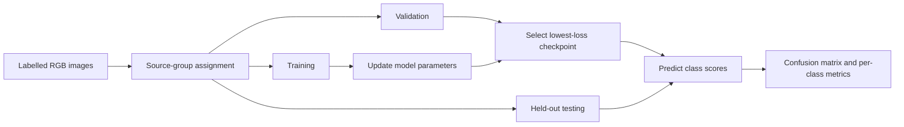

# Model and evaluation workflow

## Models

| Component | CancerCNN | ResNet-18 |
| --- | --- | --- |
| Shared 11-label input | 96 × 96 RGB | 96 × 96 RGB |
| Feature extractor | Four convolution, batch normalization, ReLU and max-pooling blocks | Four residual stages following the input stem |
| Channels | 32 → 64 → 128 → 256 | 64 → 128 → 256 → 512 |
| Pooling and output | Global average pool → 128 hidden units → 11 logits | Global average pool → dropout → 11 logits |
| Initialization in the 11-label comparison | Random | Random |

The historical 26-label configuration is separate. It uses a pretrained ResNet-18 with 128 × 128 inputs and a 26-logit head. The external lung adaptation retained the feature extractor and updated its classification head.

The pipelines share a weighted cross-entropy objective and AdamW. Augmentation is applied to training images. Validation uses deterministic preprocessing and selects the saved checkpoint. The held-out split supplies the final class predictions. See [the model implementation](../cancer_lab/model.py), [data transformations](../cancer_lab/data.py), and [training and evaluation code](../cancer_lab/engine.py).

## Reading the comparison

- CancerCNN classified 68 of 125 test images correctly. ResNet-18 classified 58 correctly under the same recorded split and training budget.
- Class F1 highlights different errors. ResNet-18 scored about 0.757 on oral squamous cell carcinoma, while CancerCNN scored about 0.105. CancerCNN had higher F1 on kidney tumor and follicular lymphoma. Both scored zero on CLL in this split.
- Lowest validation loss selected epoch 8 for CancerCNN and epoch 4 for ResNet-18. The training histories and test confusion matrices are available in [results](../results/). The [data notes](data-and-evaluation.md) describe the limits of source grouping and the small external cohort.

From the repository root, run `python tools/summarize_results.py` to recompute the reported accuracy and F1 from the stored counts, check the selected epochs, and regenerate the comparison plots and per-class CSV. This uses the aggregate records.
